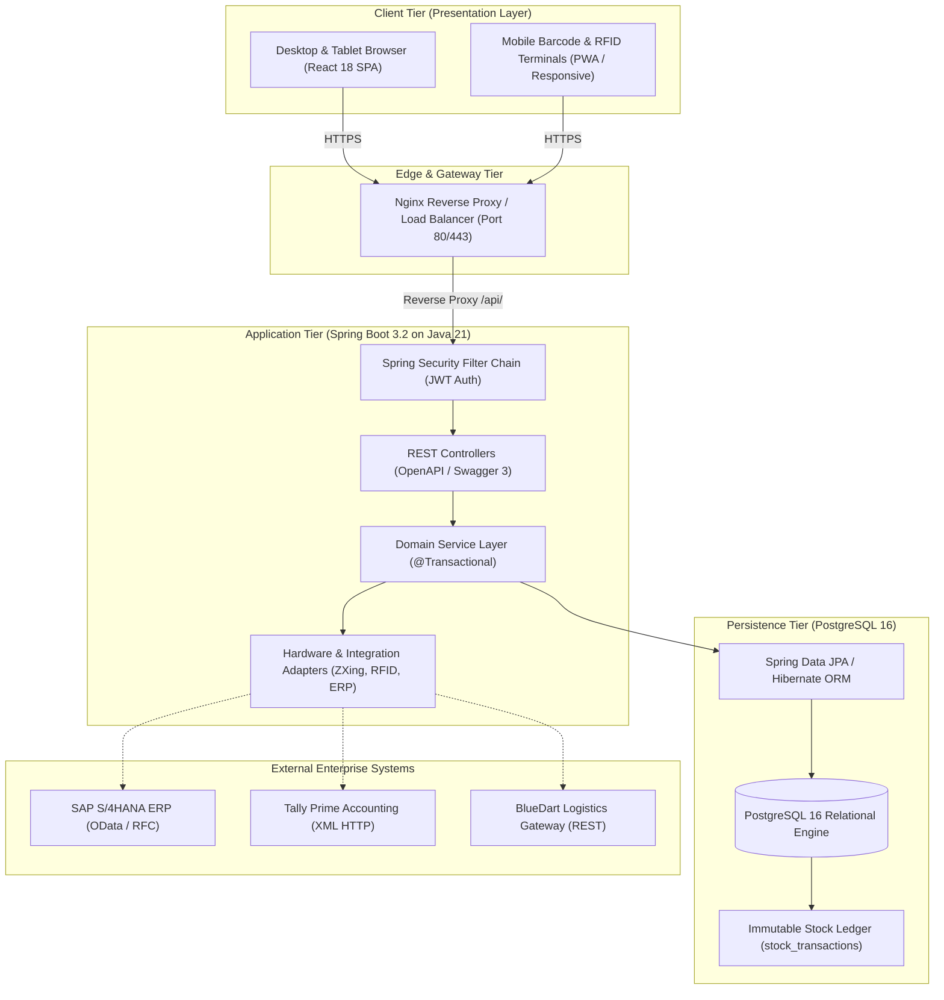
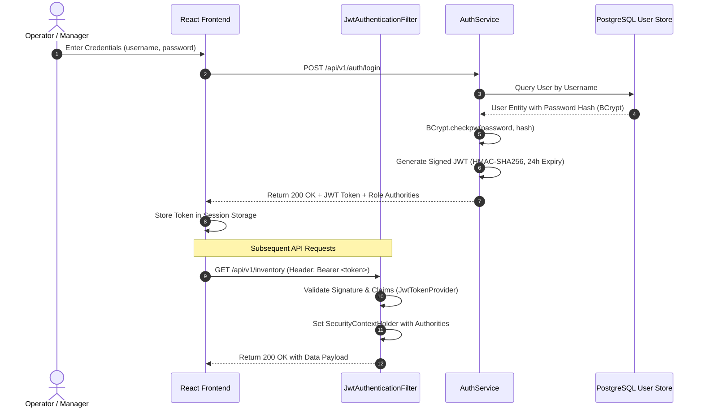

# Technical Architecture & Security Design
## Retail Inventory Management System (RIMS)
**Project Code:** `PRG_RIMS_001`  
**Client:** XYZ Retail Corporation  
**Architecture Style:** Layered Domain-Driven Monolith (Microservice Ready)  

---

## 1. Architectural Overview & System Tiers

RIMS is designed following clean architecture and Domain-Driven Design (DDD) principles. It is structured into distinct, loosely-coupled layers:



---

## 2. Backend Domain Design Patterns

### 2.1 Layered Architecture
- **Web / Controller Layer (`com.rims.*.controller`):** Handles HTTP request parsing, payload validation (`@Valid`), HTTP status mapping, and OpenAPI documentation.
- **Service Layer (`com.rims.*.service`):** Contains pure business logic, invariants enforcement (zero-negative stock, pricing validity), orchestration across repositories, and transaction management (`@Transactional`).
- **Data Access Layer (`com.rims.*.repository`):** Spring Data JPA repositories with custom JPQL queries, indexing hints, and pagination support.
- **Entity Layer (`com.rims.*.entity`):** JPA entities mapped to PostgreSQL relational tables with `@Entity`, constraints, and relationships.

### 2.2 Concurrency & Transaction Management
Inventory updates represent the highest risk for race conditions. RIMS prevents overselling through:
1. **Atomic Invariant Checks:**
   ```java
   int available = inventory.getQuantity() - inventory.getReservedQuantity();
   if (requestedQty > available) {
       throw new InsufficientStockException("Insufficient stock! Available: " + available);
   }
   ```
2. **ACID Transaction Boundaries:**
   Every stock transfer between facilities executes inside a single `@Transactional(rollbackFor = Exception.class)` boundary. If either the debit or credit fails, the entire transaction rolls back.
3. **Immutable Ledger Pattern:**
   Direct mutations to stock balances are accompanied by an immutable record insertion in `stock_transactions` containing the previous balance, new balance, delta, reason, user, and timestamp.

---

## 3. Security Architecture & RBAC Matrix

### 3.1 Authentication Workflow


### 3.2 Role-Based Access Control (RBAC)
Method-level security is enforced via Spring Security `@PreAuthorize`:
- `@PreAuthorize("hasAnyRole('SUPER_ADMIN', 'ADMIN')")` protects user provisioning and system settings.
- `@PreAuthorize("hasAnyRole('SUPER_ADMIN', 'ADMIN', 'WAREHOUSE_MANAGER', 'INVENTORY_STAFF')")` protects stock receipts and transfers.
- `@PreAuthorize("hasAnyRole('SUPER_ADMIN', 'ADMIN', 'PROCUREMENT_MANAGER')")` protects purchase order creation and approval.

---

## 4. Hardware Integration Design (Barcode & RFID)

### 4.1 ZXing Code 128 Engine
Barcode generation employs the Zebra Crossing (ZXing) Java library:
```java
BitMatrix bitMatrix = new MultiFormatWriter().encode(barcodeText, BarcodeFormat.CODE_128, width, height);
ByteArrayOutputStream out = new ByteArrayOutputStream();
MatrixToImageWriter.writeToStream(bitMatrix, "PNG", out);
byte[] pngBytes = out.toByteArray();
```

### 4.2 Pluggable RFID Reader Adapter Pattern
To maintain enterprise modularity without requiring physical hardware present during build/test cycles:
```java
public interface RfidReaderAdapter {
    List<RfidTagReadResult> readPallet(String gateId, int expectedTimeoutMs);
    boolean testConnection(String gateId);
}
```
The implementation `SimulatedRfidReaderAdapter` mimics real-world UHF RFID portal gates (865-868 MHz ETSI band), returning realistic EPC Gen 2 tags, antenna IDs, and RSSI signal strengths (-40 to -65 dBm).

---
© 2026 XYZ Retail Corporation • Document Reference: `PRG_RIMS_001_ARCH_V2`

