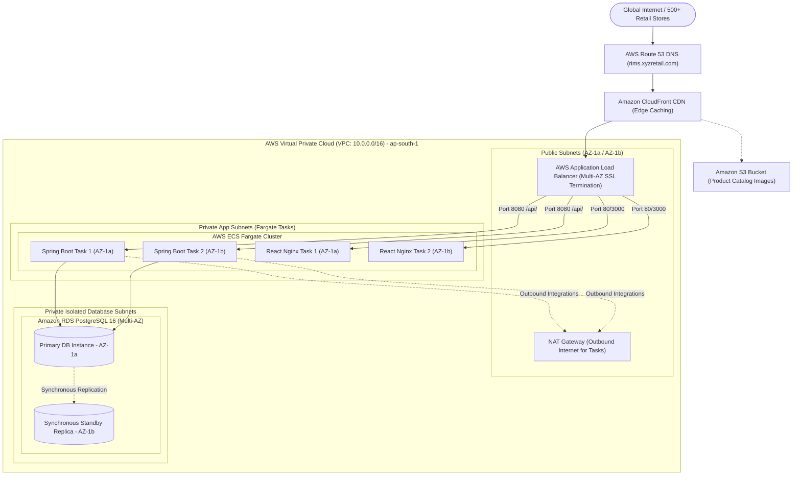

# Cloud Deployment Guide & AWS Infrastructure Architecture
## Retail Inventory Management System (RIMS)
**Project Code:** `PRG_RIMS_001`  
**Client:** XYZ Retail Corporation  
**Cloud Provider:** Amazon Web Services (AWS)  
**Target Region:** `ap-south-1` (Mumbai, India)  

---

## 1. AWS Production Infrastructure Architecture

RIMS is deployed across a highly available, multi-AZ (Availability Zone) enterprise architecture on AWS designed for 99.9% uptime SLA:



---

## 2. Infrastructure Specifications

| Component | AWS Service | Specification / Configuration |
| :--- | :--- | :--- |
| **Compute Engine** | AWS ECS Fargate | Serverless container compute, 4 vCPU, 8GB RAM per backend task; Auto-scaling 2 to 10 tasks based on CPU/Memory > 70%. |
| **Frontend CDN** | Amazon CloudFront | Global edge distribution, HTTPS TLS 1.3, gzip/brotli compression, TTL 86400s on static JS/CSS. |
| **Database** | Amazon RDS PostgreSQL | PostgreSQL 16.2, `db.r6g.xlarge` (4 vCPU, 32GB RAM), Multi-AZ synchronous replication, 500GB Provisioned IOPS SSD (io2). |
| **Container Registry**| Amazon ECR | Private Docker repositories for `rims-backend` and `rims-frontend` with automated image scanning on push. |
| **Asset Storage** | Amazon S3 | `xyz-retail-rims-product-assets` bucket with SSE-S3 encryption and lifecycle rules moving old assets to Glacier. |
| **Secrets & Config** | AWS Secrets Manager | Secure injection of database credentials, JWT private signing key, and SAP ERP connection strings. |
| **Monitoring** | Amazon CloudWatch | Application metrics, Container Insights, alarms triggered if API 5xx rate > 1% or p95 latency > 500ms. |

---

## 3. Local Container Deployment (Docker Compose)

To spin up the entire production-like environment locally in Docker:

### Step 1: Clone & Configure
```bash
git clone https://github.com/xyz-retail/rims-platform.git
cd "Retail Inventory Management System"

# Copy environment variables
cp .env.example .env
```

### Step 2: Build & Launch
```bash
docker-compose up --build -d
```

### Step 3: Verify Running Services
```bash
docker-compose ps
```
Output:
```
NAME                  COMMAND                  SERVICE         STATUS              PORTS
rims-postgres-db      "docker-entrypoint.s…"   rims-db         running (healthy)   0.0.0.0:5432->5432/tcp
rims-spring-backend   "sh -c 'java $JAVA_O…"   rims-backend    running (healthy)   0.0.0.0:8080->8080/tcp
rims-web-frontend     "nginx -g 'daemon of…"   rims-frontend   running (healthy)   0.0.0.0:3000->80/tcp
```

### Step 4: Health Checks
- Frontend: `http://localhost:3000`
- Backend API: `http://localhost:8080/api/v1/health`
- Backend Swagger UI: `http://localhost:8080/swagger-ui.html`
- PostgreSQL: `localhost:5432` (User: `rims_user`, DB: `rims_db`)

---

## 4. Zero-Downtime Rolling Deployment Strategy

During production promotion via Jenkins CI/CD:
1. Jenkins triggers an AWS ECS deployment with `minimumHealthyPercent = 100` and `maximumPercent = 200`.
2. ECS starts new container tasks running the updated Docker tag.
3. ALB routes traffic only to new tasks once the container healthcheck (`/actuator/health`) responds HTTP 200 OK.
4. Old tasks are gracefully drained and stopped without dropping active POS transactions.

---
© 2026 XYZ Retail Corporation • Document Reference: `PRG_RIMS_001_DEPLOY_V2`

