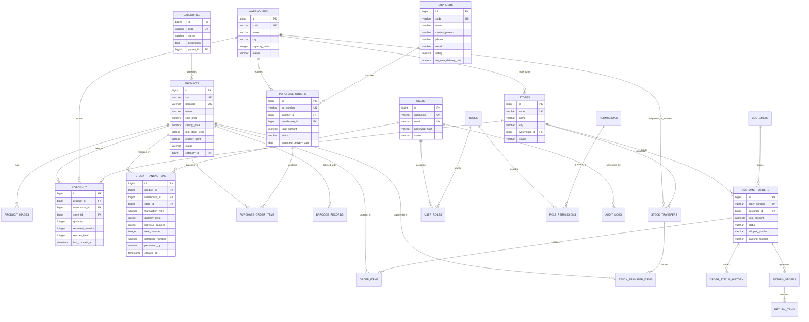

# Entity-Relationship (ER) Diagram
## Retail Inventory Management System (RIMS)
**Project Code:** `PRG_RIMS_001`  
**Client:** XYZ Retail Corporation  
**Engine:** PostgreSQL 16 (3NF Normalized Schema)  

---

## 1. Visual Entity-Relationship Architecture

The diagram below represents the core database relationships across Catalog, Inventory, Locations, Procurement, Customer Orders, and Ledger Auditing:

---

## 2. Cardinality & Foreign Key Constraints

1. **One-to-Many (`CATEGORIES` → `PRODUCTS`):** Every category contains multiple products. Deleting a category with active products is restricted.
2. **One-to-Many (`PRODUCTS` / `LOCATIONS` → `INVENTORY`):** Every product has specific stock records per warehouse or store with a database unique composite constraint (`product_id`, `warehouse_id`) and (`product_id`, `store_id`).
3. **One-to-Many (`PURCHASE_ORDERS` → `PURCHASE_ORDER_ITEMS`):** Cascade delete permitted only when PO is in `DRAFT` status.
4. **One-to-Many (`CUSTOMER_ORDERS` → `ORDER_ITEMS`):** Immutable once the order transitions to `CONFIRMED`.
5. **Append-Only (`STOCK_TRANSACTIONS`):** No `UPDATE` or `DELETE` operations permitted on the transaction ledger.

---
© 2026 XYZ Retail Corporation • Document Reference: `PRG_RIMS_001_ERD_V2`

