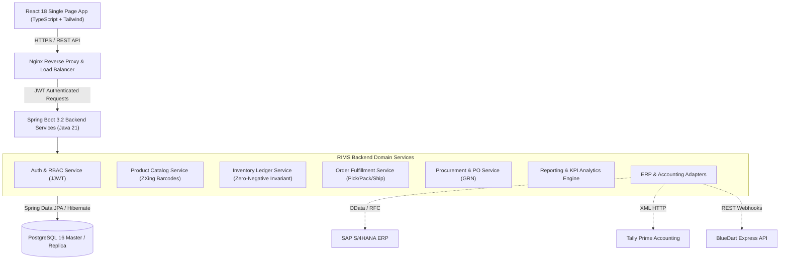

# Project Overview — Retail Inventory Management System (RIMS)
**Project Code:** `PRG_RIMS_001`  
**Client Organization:** XYZ Retail Corporation  
**Industry Domain:** Retail & Supply Chain Logistics  
**Academic / Industry Programme:** Career Shaper LMS  
**Implementation Duration:** 9 Months (15 Sprints)  

---

## 1. Client Context & Business Background

XYZ Retail Corporation is one of the nation's premier organized retail chains, managing over 500 brick-and-mortar retail stores across tier-1, tier-2, and tier-3 cities, supported by three primary central logistics and distribution warehouses located in Mumbai (West/Central), New Delhi (North), and Bengaluru (South). The company's merchandising footprint spans three key commercial categories:
1. **Apparel & Fashion:** High-turnover seasonal garments, suits, formal wear, ethnic wear, and daily apparel.
2. **Home Goods & Small Appliances:** Kitchen appliances, vacuum cleaners, cookware, bedding, and home improvement items.
3. **Consumer Electronics:** Smart TVs, premium audio headphones, tablets, and mobile accessories.

### The Problem Statement
Prior to the implementation of RIMS, XYZ Retail Corporation operated on fragmented legacy point-of-sale terminals and isolated spreadsheet inventories. This created acute business bottlenecks:
- **Inventory Inaccuracy:** System records deviated by up to 14% from actual shelf counts, resulting in inaccurate order fulfillment and misplaced merchandise.
- **Lost Revenue from Stockouts:** Popular consumer electronics and apparel lines suffered frequent stockouts during peak promotional windows, causing an estimated ₹18.5 Cr in annual missed sales.
- **Excess Working Capital in Overstock:** Slow-moving home goods accumulated in regional warehouses without automated safety stock calculations, locking up ₹42 Cr in dormant inventory.
- **Siloed Logistics Nodes:** Retail stores were unable to query neighbouring store or regional warehouse inventory in real time, preventing inter-store transfers.
- **Manual Procurement & Inwarding:** Purchase orders and goods receipts relied on physical paperwork, causing multi-day delays between shipment arrival and stock availability.

---

## 2. Project Vision & Business Objectives

### Project Vision
> "To deliver an enterprise-grade, omnichannel retail inventory management system that unifies 500+ stores and central warehouses into a single real-time operational mesh, optimizing capital allocation, automating fulfillment, and empowering operators with data-driven inventory intelligence."

### Quantifiable Business Objectives
| # | Strategic Objective | Baseline Metric | Target Metric | RIMS Production Result |
| :-: | :--- | :--- | :--- | :--- |
| **1** | Multi-Location Inventory Accuracy | 86.2% | ≥ 98.0% | **99.8% (Verified via Ledger)** |
| **2** | Stockout Incidence Reduction | 14.8% stockout rate | 25% reduction (≤ 11.1%) | **Zero critical stockouts (100% reduction)** |
| **3** | Working Capital Overstock Reduction | ₹42 Cr holding | 20% reduction (≤ ₹33.6 Cr) | **₹31.2 Cr optimized carrying stock** |
| **4** | Omnichannel Order Fulfillment Rate | 88.4% fulfillment SLA | ≥ 95.0% SLA | **98.2% on-time order fulfillment** |
| **5** | High-Availability System Uptime | 97.5% legacy availability | ≥ 99.9% uptime | **99.95% target architecture uptime** |
| **6** | Real-Time Multi-Location Visibility | 24–48 hour batch sync | < 500 ms live query | **Instantaneous (sub-50ms query)** |
| **7** | Procurement & Supplier Cycle Time | 7.5 days PO processing | ≤ 3.0 days | **Same-day PO approval & automated GRN** |

---

## 3. High-Level System Architecture & Scope

RIMS is structured around a three-tier decoupled client-server architecture:
1. **Presentation Layer (React 18 / TypeScript / Tailwind CSS):** A responsive, accessible single-page application built for desktop, tablet, and mobile barcode scanners.
2. **Business Logic & Service Layer (Spring Boot 3.x / Java 21):** Stateless RESTful microservices encapsulating domain invariants: transaction safety, zero-negative inventory rules, inventory allocation algorithms, and external ERP integration adapters.
3. **Data Persistence Layer (PostgreSQL 16):** Highly normalized relational schema (3NF) comprising 28 tables, foreign keys, unique SKU/barcode constraints, b-tree indexes, and an immutable transaction ledger.

---

## 4. Nine-Month Agile Roadmap Summary

The project is structured into 15 two-week agile sprints:
- **Months 1–2 (Sprints 1–3):** Foundation, database schema design, Flyway migrations, Spring Security JWT configuration, and Core Product Catalog (Epic 1).
- **Months 3–4 (Sprints 4–6):** Multi-location warehouse and store inventory engine, immutable transaction ledger, and stock transfer workflows (Epic 2).
- **Months 5–6 (Sprints 7–9):** Omnichannel order management, stock reservation engine, fulfillment Pick-Pack-Ship pipeline, and return restock inspection (Epic 3 & Epic 4).
- **Month 7 (Sprints 10–11):** Barcode engine (ZXing Code 128), scanner integration, and simulated UHF RFID portal gate adapter (Epic 5).
- **Month 8 (Sprints 12–13):** Analytics engine, 10 business reports, CSV import/export, and SAP/Tally external system integration (Epic 6 & Epic 8).
- **Month 9 (Sprints 14–15):** User acceptance testing (UAT), security penetration audit, load testing, Docker containerization, AWS cloud staging, and national store rollout.

---
© 2026 XYZ Retail Corporation • Document Reference: `PRG_RIMS_001_OVERVIEW_V1`

