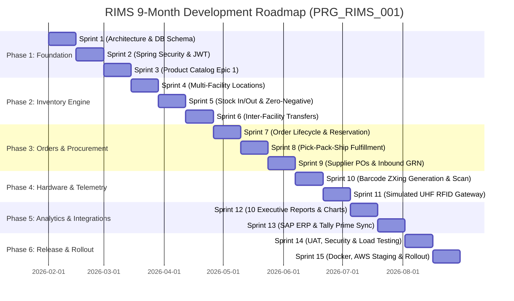

# Agile Project Plan & 9-Month Implementation Schedule
## Retail Inventory Management System (RIMS)
**Project Code:** `PRG_RIMS_001`  
**Client:** XYZ Retail Corporation  
**Timeline:** 9 Calendar Months (36 Weeks / 15 Sprints)  
**Methodology:** Agile Scrum (2-Week Sprint Cadence)  

---

## 1. Team Composition & Resource Allocation

| Role / Discipline | Headcount | Key Deliverables |
| :--- | :---: | :--- |
| **Senior Software Architect (Lead)** | 1 | Microservices design, security architecture, schema invariants |
| **Java Backend Developers** | 3 | Spring Boot 3 services, JPA repositories, Flyway migrations, REST APIs |
| **React / Frontend Developers** | 2 | React 18 SPA, Tailwind styling, Recharts, Lucide UI integration |
| **Database Architect & DBA** | 1 | PostgreSQL 16 3NF schema, B-Tree indexes, WAL, query tuning |
| **DevOps & Cloud Engineer** | 1 | Dockerfiles, Docker Compose, Jenkins CI/CD, AWS ECS/RDS staging |
| **QA / Automation Engineer** | 2 | JUnit 5, Mockito, Postman suites, performance load testing |
| **Scrum Master / Agile PM** | 1 | Sprint planning, velocity burndown tracking, stakeholder reporting |

---

## 2. 15-Sprint Milestone Schedule (36 Weeks)

### Detailed Sprint Breakdown
- **Sprint 1 (Weeks 1–2): Architecture, Relational Schema & Flyway**
  - Finalize 28-table PostgreSQL schema with check constraints and foreign keys.
  - Setup Maven multi-module structure, Lombok, Flyway migrations (`V1__init_schema.sql`, `V2__seed_data.sql`).
- **Sprint 2 (Weeks 3–4): Security & Identity Foundation (Epic 7)**
  - Implement Spring Security 6 stateless filter chain with JJWT 0.12.5.
  - Implement BCrypt password encryption (cost factor 12) and 8 functional roles.
- **Sprint 3 (Weeks 5–6): Product Catalog Management (Epic 1)**
  - REST endpoints for Product CRUD with unique SKU & barcode enforcement.
  - Apache Commons CSV streaming for bulk catalog import and export.
- **Sprint 4 (Weeks 7–8): Multi-Facility Locations (Epic 2)**
  - Warehouse and Retail Store management modules.
  - Multi-location inventory distribution mapping.
- **Sprint 5 (Weeks 9–10): Core Stock Operations & Ledger (Epic 2)**
  - Stock-In and Stock-Out transactions with zero-negative stock validation.
  - Append-only `stock_transactions` immutable ledger.
- **Sprint 6 (Weeks 11–12): Inter-Facility Stock Transfers (Epic 2)**
  - Stock transfers between warehouses and stores (`REQUESTED` → `IN_TRANSIT` → `COMPLETED`).
  - Single atomic `@Transactional` balance update.
- **Sprint 7 (Weeks 13–14): Order Management & Reservation (Epic 3)**
  - Sales order creation with immediate stock reservation.
  - Order cancellation releasing reserved inventory back to available.
- **Sprint 8 (Weeks 15–16): Fulfillment Pipeline & Returns (Epic 3)**
  - Pick-Pack-Ship operational workflow.
  - Customer return inspection (`RESTOCKABLE` vs `DAMAGED`) and restock crediting.
- **Sprint 9 (Weeks 17–18): Procurement & Purchase Orders (Epic 4)**
  - Vendor directory and PO creation lifecycle (`DRAFT` → `APPROVED`).
  - Inward Goods Receipt (GRN) automatically crediting warehouse stock.
- **Sprint 10 (Weeks 19–20): Barcode Generation & Scanning (Epic 5)**
  - Code 128 barcode generation via ZXing.
  - Camera-based and USB HID barcode scanner terminal.
- **Sprint 11 (Weeks 21–22): UHF RFID Portal Reader Simulation (Epic 5)**
  - Pluggable `RfidReaderAdapter` interface.
  - High-throughput pallet pass-through simulation (20+ EPC tags per read).
- **Sprint 12 (Weeks 23–24): Executive Dashboard & 10 Reports (Epic 6)**
  - Real-time database KPI computation (no hardcoded figures).
  - 6 visual Recharts components and 10 official business reports.
- **Sprint 13 (Weeks 25–26): Enterprise ERP & Accounting Connectors (Epic 8)**
  - Mock SAP S/4HANA OData adapter.
  - Mock Tally Prime accounting XML connector and BlueDart courier AWB gateway.
- **Sprint 14 (Weeks 27–28): Quality Assurance, Security Audit & Load Testing**
  - Execute automated JUnit 5 / Mockito test suite.
  - Conduct Apache JMeter load tests simulating 500 concurrent retail terminals.
- **Sprint 15 (Weeks 29–30): Production Packaging, AWS Staging & Rollout**
  - Docker multi-stage containerization (Spring Boot JRE runtime & React Nginx).
  - Configure Jenkins declarative CI/CD pipeline and execute AWS ECS Fargate deployment.

---

## 3. Risk Management & Mitigation Matrix

| Risk ID | Risk Description | Severity | Probability | Mitigation Strategy |
| :---: | :--- | :---: | :---: | :--- |
| **RSK-01** | Concurrent order placements causing negative inventory | HIGH | HIGH | Invariant validation in service layer, database check constraint (`quantity >= 0`), and atomic stock reservation. |
| **RSK-02** | Network latency between regional retail stores and central DB | MEDIUM | MEDIUM | Nginx reverse proxy edge caching for static assets, connection pooling (HikariCP), and indexed queries. |
| **RSK-03** | Inability to access physical RFID hardware in dev/test | MEDIUM | HIGH | Implementation of pluggable `SimulatedRfidReaderAdapter` conforming exactly to EPC Gen 2 telemetry specs. |
| **RSK-04** | Large catalog CSV uploads exhausting server memory | HIGH | MEDIUM | Apache Commons CSV chunked streaming with asynchronous background processing and row-level validation. |
| **RSK-05** | Unauthorized access to pricing or inventory adjustments | CRITICAL| LOW | Stateless HMAC-SHA256 JWT tokens with Spring Security `@PreAuthorize` role checking and immutable audit trail. |

---
© 2026 XYZ Retail Corporation • Document Reference: `PRG_RIMS_001_PLAN_V2`

