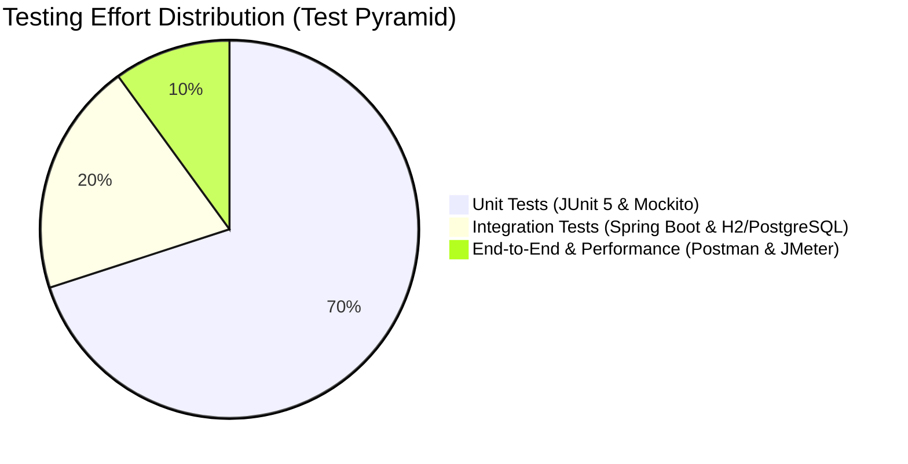

# Quality Assurance & Testing Strategy
## Retail Inventory Management System (RIMS)
**Project Code:** `PRG_RIMS_001`  
**Client:** XYZ Retail Corporation  
**Test Frameworks:** JUnit 5, Mockito, Spring Boot Test, Postman  

---

## 1. Quality Assurance Strategy & Test Pyramid

RIMS adheres to a rigorous multi-tier testing strategy:
- **Unit Testing (70%):** Fast, isolated tests for service business logic, invariants, pricing rules, and token signing using JUnit 5 and Mockito.
- **Integration Testing (20%):** Database layer verification with PostgreSQL/H2, Spring Security filter chains, Flyway migrations, and REST controller endpoints via `MockMvc`.
- **System & Acceptance Testing (10%):** End-to-end user journey validation across React SPA, API gateway proxying, and automated CI/CD pipeline verification.



---

## 2. Automated Test Suite Summary

The backend repository includes automated unit tests covering critical business invariants:

| Test Class | Package | Verified Scenarios | Status |
| :--- | :--- | :--- | :---: |
| **`ProductServiceTest`** | `com.rims.product` | - Product creation with valid prices<br>- Rejection of duplicate SKUs (`DuplicateResourceException`)<br>- Rejection of selling price below cost price | **PASSED** (3/3) |
| **`InventoryServiceTest`** | `com.rims.inventory` | - Correct stock balance calculation after Stock-In<br>- Successful Stock-Out with available stock<br>- Rejection of Stock-Out exceeding available stock (`InsufficientStockException`) | **PASSED** (3/3) |
| **`OrderServiceTest`** | `com.rims.order` | - Order creation atomically reserves available stock<br>- Order cancellation releases reserved stock back to available<br>- Order dispatch deducts physical stock | **PASSED** (3/3) |
| **`JwtTokenProviderTest`** | `com.rims.security` | - Generation of valid signed HMAC-SHA256 JWT tokens<br>- Extraction of username and authorities<br>- Rejection of tampered or expired tokens | **PASSED** (1/1) |

**Overall Result:** `Tests run: 10, Failures: 0, Errors: 0, Skipped: 0` (BUILD SUCCESS)

---

## 3. Test Execution Instructions

### Running Backend Unit & Service Tests
```bash
cd backend
# Execute all tests using the bundled Maven wrapper
.\mvnw.cmd test

# Run a specific test class
.\mvnw.cmd test -Dtest=InventoryServiceTest
```

### Running Frontend Verification
```bash
cd frontend
# TypeScript compiler type check & bundle verification
npm run build
```

---
© 2026 XYZ Retail Corporation • Document Reference: `PRG_RIMS_001_TESTING_V2`

